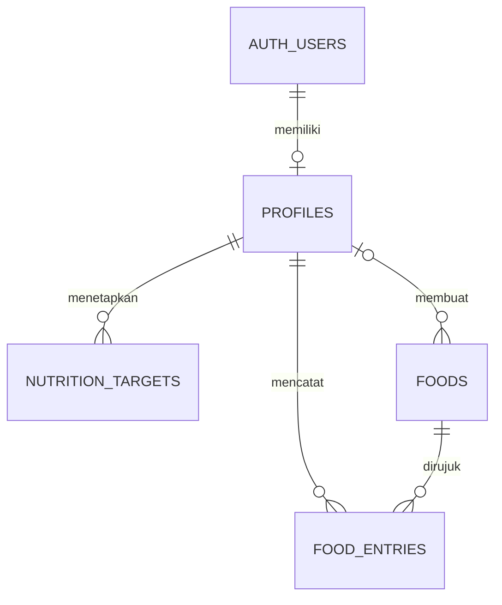
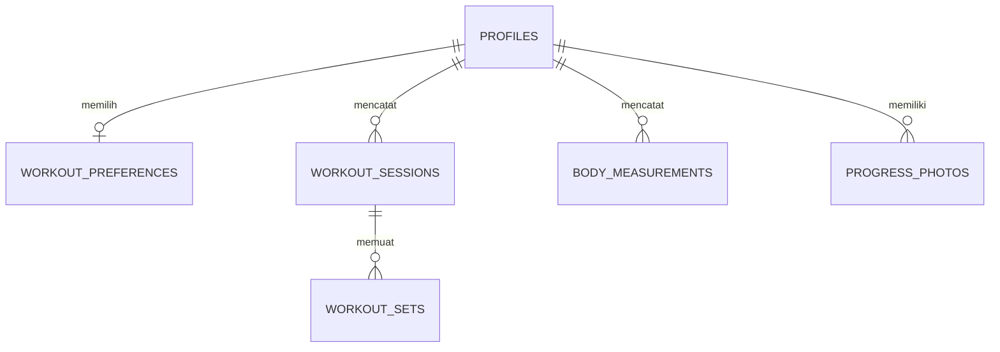

# Arsitektur FORMA 0.1.0

Next.js App Router menjalankan halaman autentikasi dan halaman privat. React Client Components menangani interaksi formulir, pencarian, dan pratinjau. Server Actions memvalidasi input, mengambil identitas dari Supabase Auth, dan menulis melalui PostgREST dengan hak pengguna. PostgreSQL menegakkan RLS dan menghitung snapshot nutrisi. Aplikasi memakai publishable key, dengan izin baris ditentukan oleh sesi pengguna.

| Migrasi | Isi |
| --- | --- |
| `20261112161934_foundation.sql` | Profil, target bertanggal efektif, onboarding atomik, RLS |
| `20261112161935_nutrition.sql` | Katalog dan jurnal, trigger snapshot, kolom gizi terhitung, indeks harian, kebijakan kepemilikan |
| `20261112162007_food_catalog.sql` | Delapan pangan rujukan dengan kode sumber dan metode pengolahan |
| `20261112165621_onboarding_targets_and_start_date.sql` | Pisahkan tanggal mulai program dari tanggal efektif target dan izinkan pemilik mengedit tanggal mulai |
| `20261112165623_everyday_food_catalog.sql` | Dua belas pangan tambahan dengan porsi dan catatan komposisi |
| `20261112174411_workout_and_progress.sql` | Jadwal, sesi, set, pengukuran, penguncian sesi dan RLS |
| `20261112174414_progress_photo_storage.sql` | Bucket foto privat dan akses menurut pemilik folder |
| `20261113035208_reminders_and_profile_corrections.sql` | Jadwal privat, klaim notifikasi, koreksi profil dan set, jumlah set saat sesi ditutup, snapshot porsi |

## Keputusan dan konsekuensi

- **SSR dengan cookie.** Proxy memperbarui token. Cookie sesi memakai HttpOnly dan SameSite Lax, serta Secure ketika origin aplikasi HTTPS. Halaman privat dan setiap mutasi memeriksa klaim identitas. Respons pribadi memakai `private, no-store`. Kewenangan data tetap ditegakkan oleh RLS walaupun pemanggil menggunakan PostgREST langsung. [Supabase SSR](https://supabase.com/docs/guides/auth/server-side) · [Next.js Proxy](https://nextjs.org/docs/app/getting-started/proxy)
- **Transaksi onboarding.** Profil dan target pertama ditulis oleh satu RPC dengan hak pemanggil. Percobaan ulang untuk pengguna yang sudah memiliki profil tidak menimpa nilai yang tersimpan.
- **Riwayat gizi.** PostgreSQL mengambil nilai referensi dari makanan yang dapat dibaca pengguna. Snapshot energi/makro dibuat dengan tipe numerik dan formula nilai per 100 g × gram ÷ 100. Edit jumlah memakai referensi saat catatan dibuat. UI membulatkan tampilan setelah perhitungan, sedangkan ekspor mempertahankan presisi database.
- **Waktu konsumsi.** `consumed_at` memakai `timestamptz`. Jurnal memakai `local_date` yang dihitung database dari zona waktu pada catatan. Waktu lokal di formulir dikonversi ke UTC dengan Temporal. Zona waktu profil versi ini terbatas pada WIB, WITA, dan WIT.
- **Duplikasi dan konflik.** Formulir penambahan memakai UUID yang sama ketika pengiriman diulang. Mutasi edit dan hapus memakai versi `updated_at` sehingga tab lama menerima pesan konflik. Target harian memiliki satu baris per akun dan tanggal efektif. Perubahan pada tanggal yang sama mengganti target tanggal tersebut.
- **Katalog dan ekspor.** Makanan rujukan dikelola lewat migrasi. Makanan pribadi dan jurnal dapat dibaca oleh pemilik. Unduhan JSON meminta data lewat sesi yang aktif. Ekspor mencakup semua halaman hasil, tetapi perubahan yang terjadi bersamaan dengan ekspor dapat terlihat dari waktu yang berbeda.
- **Kinerja.** Ringkasan harian dibaca berdasarkan indeks `(user_id, local_date, consumed_at, id)`. Pencarian di-debounce dan mengambil hingga 30 hasil. Aplikasi personal ini memakai pencarian nama langsung dengan ILIKE. Penambahan katalog besar memerlukan evaluasi indeks pencarian dan pagination.

## Pengingat dan PWA

- Jadwal disimpan dalam PostgreSQL dengan kebijakan RLS pemilik. Runtime menentukan kejadian dari hari dan zona profil, termasuk jadwal yang melewati tengah malam. Snooze memakai waktu absolut. Klaim notifikasi menguji versi pengaturan dan waktu kejadian dalam satu pembaruan bersyarat.
- Service worker menyiapkan halaman offline publik. Navigasi mencoba jaringan lebih dulu. Operasi tulis, data akun, dan foto tetap memakai koneksi dan sesi yang aktif.

## Sistem desain

| Peran | Nilai |
| --- | --- |
| Latar | `#101C29` |
| Kartu dan permukaan sekunder | `#182938`, `#213647` |
| Aksen utama | `#8BE2BB` |
| Teks dan teks sekunder | `#F2F7FA`, `#B1C2CF` |
| Makro | Protein `#8CCAFF`, karbohidrat `#EFC989`, lemak `#D8B5F3` |
| Tipografi | Inter Variable yang dibundel lokal, angka tabular untuk data |
| Interaksi | Fokus terlihat, input 46 px, tombol utama minimal 44 px, dan navigasi bawah dengan safe-area |

Beranda menempatkan asupan energi dan sisa target di bagian atas. Nutrisi menampilkan riwayat per waktu makan, dengan tautan ke formulir yang membawa tanggal dan kelompok makan. Riwayat dan formulir tampil berdampingan pada layar lebar. Navigasi HP menempatkan Catat di antara Beranda, Nutrisi, Latihan, dan Progres. Profil dan Pengingat tersedia pada header. Cincin energi dan batang makro membaca nilai dari jurnal dan target pengguna.

## Sumber katalog

Satuan dasar adalah 100 g bagian yang dapat dimakan. Berat porsi hanya disediakan untuk baris dengan satuan referensi. Nilai makanan yang sebenarnya dapat berbeda sesuai varietas dan pengolahan.

| Pangan | Referensi | Energi (kkal) | Protein (g) | Karbo (g) | Lemak (g) |
| --- | --- | ---: | ---: | ---: | ---: |
| Nasi putih matang, beras bulir panjang | USDA SR28 20045 | 130 | 2,69 | 28,17 | 0,28 |
| Telur ayam rebus | USDA SR28 01129 | 155 | 12,58 | 1,12 | 10,61 |
| Pisang segar | USDA SR28 09040 | 89 | 1,09 | 22,84 | 0,33 |
| Dada ayam panggang, tanpa kulit | USDA SR27 05064 | 165 | 31,02 | 0 | 3,57 |
| Tahu putih mentah | TKPI CP061 | 80 | 10,9 | 0,8 | 4,7 |
| Tahu goreng | TKPI CP062 | 115 | 9,7 | 2,5 | 8,5 |
| Tempe kedelai murni goreng | TKPI CP076 | 350 | 24,5 | 10,4 | 26,6 |
| Tempe kedelai murni mentah | TKPI CP077 | 201 | 20,8 | 13,5 | 8,8 |

Rujukan [TKPI Kementerian Kesehatan](https://repository.kemkes.go.id/book/777), [tabel TKPI untuk pencocokan kode](https://anyflip.com/zmbsf/izxk/basic), [USDA beras](https://www.ars.usda.gov/ARSUserFiles/80400535/Data/SR/SR28/reports/sr28fg20.pdf), [USDA telur](https://www.ars.usda.gov/ARSUserFiles/80400535/Data/SR/SR28/reports/sr28fg01.pdf), [USDA pisang](https://www.ars.usda.gov/ARSUserFiles/80400535/Data/SR/SR28/reports/sr28fg09.pdf), [USDA ayam](https://www.ars.usda.gov/ARSUserFiles/80400525/Data/SR27/reports/sr27fg05.pdf).

BMR menggunakan persamaan Mifflin–St Jeor. Pengali aktivitas adalah asumsi produk yang ditampilkan di formulir. [Mifflin et al. 1990](https://pubmed.ncbi.nlm.nih.gov/2305711/).

## Target otomatis dan tanggal program

IMT dihitung dari berat dibagi tinggi kuadrat dalam meter. Energi awal menggunakan TDEE dari estimasi Mifflin–St Jeor dan pengali aktivitas. Pilihan menjaga berat dan mencatat memakai TDEE. Untuk turun lemak, penyesuaian awal adalah maksimum 10% atau 300 kkal di bawah TDEE, dengan batas aplikasi 1.500 kkal dan tanpa pengurangan saat IMT di bawah 18,5. Pilihan naik berat memakai tambahan maksimum 10% atau 250 kkal. Untuk TDEE di bawah 1.500 kkal, kalkulator tidak menawarkan target otomatis. Asumsi aplikasi dapat diganti dengan isian manual.

Kalori dibulatkan ke 10 kkal, protein dihitung dari sekitar 25% energi dan lemak dari sekitar 30% energi. Karbohidrat memakai energi tersisa agar target kalori dan makro konsisten. Form otomatis memakai perhitungan yang sama dengan Server Action. Rujukan [IMT CDC](https://www.cdc.gov/bmi/about/index.html), [Mifflin et al.](https://pubmed.ncbi.nlm.nih.gov/2305711/), dan [rentang makro dewasa](https://www.nationalacademies.org/read/10925/chapter/25).

Tanggal mulai program dapat berupa tanggal lampau atau mendatang. Saat onboarding, tanggal efektif target pertama adalah tanggal yang lebih awal antara tanggal mulai dan hari ini di zona waktu profil. Edit tanggal mulai dan data profil memakai izin kolom terpisah pada baris milik pengguna. Riwayat target dan jurnal mempertahankan tanggalnya.

## Hidangan sehari-hari

Dua belas tambahan katalog mencakup hidangan nasi, roti, camilan dan minuman. SQL menyimpan takaran acuan dalam gram dan menghitung profil per 100 g sebagai rerata berbobot bahan. Porsi komposit memperkirakan berat bahan yang termakan. Variasi resep, porsi dan penyerapan minyak dapat mengubah hasil. Untuk dadar sunti, berat bumbu masuk perkiraan porsi, sedangkan kontribusi gizi bumbu belum dihitung. Roti selai memakai referensi olesan coklat hazelnut. Susu coklat memakai susu coklat cair generik.

| Bahan acuan | Sumber |
| --- | --- |
| Nasi matang dan dada ayam panggang | USDA SR28 NDB 20045 dan SR27 NDB 05064 |
| Telur, ayam tepung, minyak, dan cabai | USDA FDC 171287, 171475, 171411, 170106 |
| Roti putih, olesan coklat, tepung dan susu coklat | USDA FDC 174924, 168000, 168936, 170879 |
| Tahu dan tempe goreng | TKPI CP062 dan CP076 |
| Kecap manis | Contoh label 60 kkal dan 15 g karbo per 20 g |

Rujukan [USDA FoodData Central](https://fdc.nal.usda.gov/), [TKPI](https://repository.kemkes.go.id/book/777), dan [transkripsi label kecap](https://www.aurodigo.com/informasi-bango-kecap-manis).

## Latihan dan progres

Dua rutinitas A/B memakai katalog gerakan berversi di source. Sesi menyimpan urutan gerakan aktual, minggu pada saat mulai, set yang direncanakan, status, dan waktu aktif. Set tersimpan sebagai baris terpisah dengan kunci sesi, slot, dan nomor set. Constraint satu sesi terbuka per pengguna, penguncian baris induk saat menyimpan set, dan pemeriksaan transisi melindungi sesi dari kiriman ganda dan edit riwayat selesai. Beban dicatat per alat. Gerakan satu sisi memakai jumlah repetisi yang dapat diselesaikan di kedua sisi.

Jadwal memakai tanggal mulai profil dan zona waktu lokal. Minggu 1–2 menggunakan maksimal dua hari yang dipilih. Minggu 3–12 menyediakan hingga tiga hari. Mulai minggu 5 pengguna boleh memilih dua atau tiga set. Pemilihan beban tetap manual. Perbandingan kekuatan membandingkan set terbaik dari dua sesi terbaru dengan gerakan yang sama. Ilustrasi adalah skema asli FORMA. Prinsip latihan dan petunjuk dirujuk dari [ACSM](https://pubmed.ncbi.nlm.nih.gov/41843416/), [Mayo Clinic squat](https://www.mayoclinic.org/healthy-lifestyle/fitness/multimedia/squat/vid-20084682), [row](https://www.mayoclinic.org/healthy-lifestyle/fitness/multimedia/bent-over-row/vid-20084680), dan [curl](https://www.mayoclinic.org/healthy-lifestyle/fitness/multimedia/biceps-curl/vid-20084675).

Setiap tanggal pengukuran menyimpan berat, lingkar pinggang, atau keduanya. Grafik memakai tanggal aktual dan mengabaikan nilai yang kosong. Minggu program dihitung dari tanggal mulai dan rerata memakai pengukuran yang tersedia. Berat awal dan target adalah nilai profil. Ukuran pinggang mengikuti metode [American Heart Association](https://www.heart.org/-/media/PHD-Files/Education/CKMH-Obesity-Measuring-Waist-Circumference_030226.pdf).

Foto masuk ke bucket privat `progress-photos` dengan prefiks ID akun. Aplikasi mengubah JPG, PNG, atau WebP ke JPEG dan menghapus metadata gambar sebelum unggah. Rute foto memeriksa sesi dan keberadaan objek di Storage sebelum mengambil gambar. Respons tidak disimpan di cache browser agar tautan lama ditolak setelah foto dihapus. Ekspor JSON mencakup metadata galeri. Foto dapat dibuka dan diunduh satu per satu.

