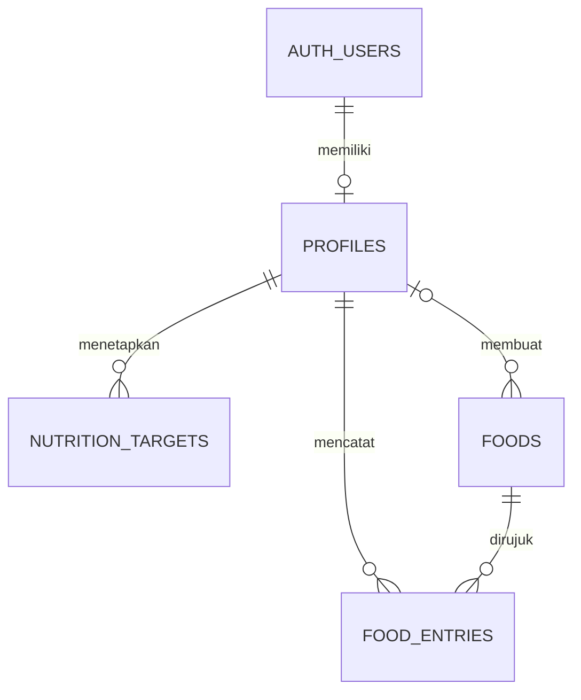

# Arsitektur FORMA 0.1.0

Next.js App Router menjalankan halaman autentikasi dan halaman privat. React Client Components menangani interaksi formulir, pencarian, dan pratinjau. Server Actions memvalidasi input, mengambil identitas dari Supabase Auth, dan menulis melalui PostgREST dengan hak pengguna. PostgreSQL menegakkan RLS dan menghitung snapshot nutrisi. Aplikasi memakai publishable key, dengan izin baris ditentukan oleh sesi pengguna.

| Migrasi | Isi |
| --- | --- |
| `20261112161934_foundation.sql` | Profil, target bertanggal efektif, onboarding atomik, RLS |
| `20261112161935_nutrition.sql` | Katalog dan jurnal, trigger snapshot, kolom gizi terhitung, indeks harian, kebijakan kepemilikan |
| `20261112162007_food_catalog.sql` | Delapan pangan rujukan dengan kode sumber dan metode pengolahan |

## Keputusan dan konsekuensi

- **SSR dengan cookie.** Proxy memperbarui token. Cookie sesi memakai HttpOnly dan SameSite Lax, serta Secure ketika origin aplikasi HTTPS. Halaman privat dan setiap mutasi memeriksa klaim identitas. Respons pribadi memakai `private, no-store`. Kewenangan data tetap ditegakkan oleh RLS walaupun pemanggil menggunakan PostgREST langsung. [Supabase SSR](https://supabase.com/docs/guides/auth/server-side) · [Next.js Proxy](https://nextjs.org/docs/app/getting-started/proxy)
- **Transaksi onboarding.** Profil dan target pertama ditulis oleh satu RPC dengan hak pemanggil. Percobaan ulang untuk pengguna yang sudah memiliki profil tidak menimpa nilai yang tersimpan.
- **Riwayat gizi.** PostgreSQL mengambil nilai referensi dari makanan yang dapat dibaca pengguna. Snapshot energi/makro dibuat dengan tipe numerik dan formula nilai per 100 g × gram ÷ 100. Edit jumlah memakai referensi saat catatan dibuat. UI membulatkan tampilan setelah perhitungan, sedangkan ekspor mempertahankan presisi database.
- **Waktu konsumsi.** `consumed_at` memakai `timestamptz`. Jurnal memakai `local_date` yang dihitung database dari zona waktu pada catatan. Waktu lokal di formulir dikonversi ke UTC dengan Temporal. Zona waktu profil versi ini terbatas pada WIB, WITA, dan WIT.
- **Duplikasi dan konflik.** Formulir penambahan memakai UUID yang sama ketika pengiriman diulang. Mutasi edit dan hapus memakai versi `updated_at` sehingga tab lama menerima pesan konflik. Target harian memiliki satu baris per akun dan tanggal efektif. Perubahan pada tanggal yang sama mengganti target tanggal tersebut.
- **Katalog dan ekspor.** Makanan rujukan dikelola lewat migrasi. Makanan pribadi dan jurnal dapat dibaca oleh pemilik. Unduhan JSON meminta data lewat sesi yang aktif. Ekspor mencakup semua halaman hasil, tetapi perubahan yang terjadi bersamaan dengan ekspor dapat terlihat dari waktu yang berbeda.
- **Kinerja.** Ringkasan harian dibaca berdasarkan indeks `(user_id, local_date, consumed_at, id)`. Pencarian di-debounce dan mengambil hingga 30 hasil. Aplikasi personal ini memakai pencarian nama langsung dengan ILIKE. Penambahan katalog besar memerlukan evaluasi indeks pencarian dan pagination.

## Sistem desain

| Peran | Nilai |
| --- | --- |
| Latar | `#101D2B` |
| Kartu dan permukaan sekunder | `#1A2B3B`, `#263D4E` |
| Aksen utama | `#8BE2BB` |
| Teks dan teks sekunder | `#F2F7FA`, `#B1C2CF` |
| Makro | Protein `#8CCAFF`, karbohidrat `#EFC989`, lemak `#D8B5F3` |
| Tipografi | Inter Variable yang dibundel lokal, angka tabular untuk data |
| Interaksi | Fokus terlihat, input 46 px, tombol utama minimal 44 px, dan navigasi bawah dengan safe-area |

Beranda menempatkan asupan energi dan sisa target di bagian atas. Nutrisi menampilkan pencatatan sebelum riwayat di ponsel dan memakai dua kolom saat lebar cukup. Tiga tujuan aktif adalah Beranda, Nutrisi, dan Profil. Latihan dan Progres ditambahkan setelah fiturnya dapat digunakan. Cincin energi dan batang makro membaca nilai dari jurnal dan target pengguna.

## Sumber katalog

Satuan dasar adalah 100 g bagian yang dapat dimakan. Berat porsi hanya disediakan untuk baris dengan satuan referensi. Nilai makanan yang sebenarnya dapat berbeda sesuai varietas dan pengolahan.

| Pangan | Referensi | Energi (kkal) | Protein (g) | Karbo (g) | Lemak (g) |
| --- | --- | ---: | ---: | ---: | ---: |
| Nasi putih matang, beras bulir panjang | USDA SR28 20045 | 130 | 2,69 | 28,17 | 0,28 |
| Telur ayam rebus | USDA SR28 01129 | 155 | 12,58 | 1,12 | 10,61 |
| Pisang segar | USDA SR28 09040 | 89 | 1,09 | 22,84 | 0,33 |
| Dada ayam panggang, tanpa kulit | USDA SR27 05064 | 165 | 31,02 | 0 | 3,57 |
| Tahu putih mentah | TKPI CP061 | 80 | 10,9 | 0,8 | 4,7 |
| Tahu goreng | TKPI CP062 | 115 | 9,7 | 2,5 | 8,5 |
| Tempe kedelai murni goreng | TKPI CP076 | 350 | 24,5 | 10,4 | 26,6 |
| Tempe kedelai murni mentah | TKPI CP077 | 201 | 20,8 | 13,5 | 8,8 |

Rujukan [TKPI Kementerian Kesehatan](https://repository.kemkes.go.id/book/777), [tabel TKPI untuk pencocokan kode](https://anyflip.com/zmbsf/izxk/basic), [USDA beras](https://www.ars.usda.gov/ARSUserFiles/80400535/Data/SR/SR28/reports/sr28fg20.pdf), [USDA telur](https://www.ars.usda.gov/ARSUserFiles/80400535/Data/SR/SR28/reports/sr28fg01.pdf), [USDA pisang](https://www.ars.usda.gov/ARSUserFiles/80400535/Data/SR/SR28/reports/sr28fg09.pdf), [USDA ayam](https://www.ars.usda.gov/ARSUserFiles/80400525/Data/SR27/reports/sr27fg05.pdf).

BMR menggunakan persamaan Mifflin–St Jeor. Pengali aktivitas adalah asumsi produk yang ditampilkan di formulir. [Mifflin et al. 1990](https://pubmed.ncbi.nlm.nih.gov/2305711/).
